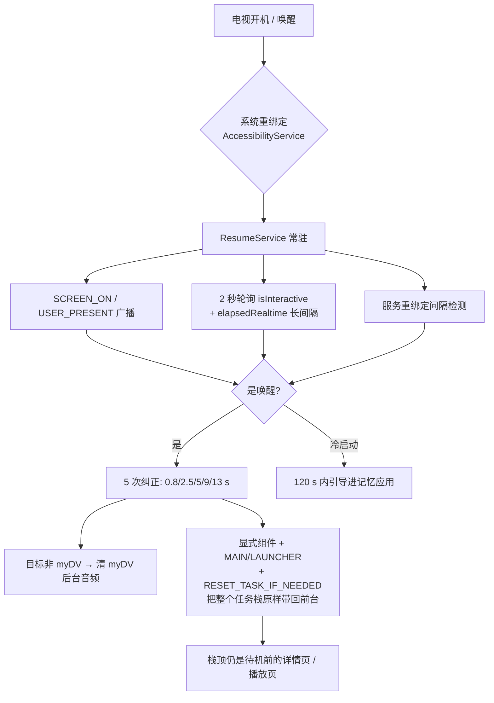

# 服务原理

> 面向想改代码的人。完整实现见 [`apk/src/com/wb/mydvresume/ResumeService.java`](../apk/src/com/wb/mydvresume/ResumeService.java)。
> 当前版本 v4.1（`versionCode 17 / 3.1`）。

## 1. 整体架构



**没有界面、没有图标、没有桌面声明**：清单里只有一个 `exported=true`、由 `BIND_ACCESSIBILITY_SERVICE` 保护的 service。TCL 验证器会拒绝含 `CATEGORY_HOME` / `LAUNCHER` / `<queries>` 声明的非 TCL 签名 APK，所以这些一律不写。开机后由系统自动重新绑定服务，不需要 `BOOT_COMPLETED`。

## 2. 唤醒检测（三重）

v1 只靠 `onAccessibilityEvent` 结果事件根本不派发，从 v2 起改成三重：

1. `SCREEN_ON` / `USER_PRESENT` 系统广播；
2. 每 2 秒轮询 `PowerManager.isInteractive()`，并用 `elapsedRealtime` 的长间隔（跨待机时长）识别「刚亮屏」；
3. `onServiceConnected` 里比较本次绑定与上次绑定的间隔，服务被 TCL `FreezeManager` 冻结后重绑定也能补一次唤醒。

命中后设 `wokeAt`，在 `DELAYS = {800, 2500, 5000, 9000, 13000}` 毫秒处执行 5 次纠正，窗口约 15 秒。**这 5 次是对抗 TCL 亮屏 2~3 秒后才把桌面抢到前台的关键**，v3.8 曾把它们压成 1 次导致功能回归，v4.0 已恢复全部执行。

## 3. v4.0 的任务栈恢复（核心）

唤醒时最终调用的 `launch()` 构造一个**干净**的 Intent：

```java
ComponentName cn = resolveBootIntent(pkg).getComponent();   // 显式组件
Intent bring = new Intent(Intent.ACTION_MAIN);
bring.addCategory(Intent.CATEGORY_LAUNCHER);
bring.setComponent(cn);
bring.setFlags(Intent.FLAG_ACTIVITY_NEW_TASK
        | Intent.FLAG_ACTIVITY_RESET_TASK_IF_NEEDED
        | Intent.FLAG_ACTIVITY_NO_ANIMATION);
startActivity(bring);
```

要点：

- **显式组件**：TCL 对第三方服务的隐式 `MAIN/LAUNCHER` intent 拒绝解析（实测连 `adb shell` 都报 unable to resolve），显式写法绕开该限制。组件来自静态表 `resolveBootIntent()`，解析不到就回退 myDV 的 `MainActivity`。
- **绝不能用 `FLAG_ACTIVITY_SINGLE_TOP`**：讴歌影视 `HomeActivity` 是 `singleTop`，而待机时栈顶通常是 `DetailActivity`，`SINGLE_TOP` 不命中就会**新建一个首页压上去**（A/B 实证：任务栈从 3 个变 4 个），这正是「进应用了、在首页、有声音没画面」的直接原因。
- `RESET_TASK_IF_NEEDED` 提供 launcher 语义：桌面在前台时系统返回 `its current task has been brought to the front`，**整个任务栈原样带回、栈顶仍是原页面、不新建任何 Activity**。
- 这个调用是**幂等**的，所以 5 次纠正可以全部执行而不会叠页面；若系统拒绝该 Intent，会 `catch` 后走 legacy fallback（旧的显式 `SINGLE_TOP` 启动），保证不会比旧版更差。
- v4.0 删除了 v3.6 的「精确恢复」分支：它每次都因 `DetailActivity` / `PlayActivity` `exported=false` 抛 `SecurityException`，且可能抢先返回；任务栈复用已能保留整个栈顶，不需要它。`SCREEN_OFF` 时仍会记录当时的 class，用于诊断日志和 `--wake-report`。

## 4. 冷启动目标（C 折中）

- 用 `boot_id` 变化 / `elapsedRealtime` 负间隔判断是冷启动而非唤醒。
- `UsageStatsManager` 的 `ACTIVITY_RESUMED` 与 `class=` 事件流判断关机/待机前最后用的应用，辅以本地 `last_app` 兜底。
- 默认回 myDV；只有在 `wb_boot_whitelist` 白名单内才记忆上次应用，否则回退默认。
- 120 秒纠正窗口；用户按键或主动打开别的应用即取消劫持，避免抢操作。
- 冷启动 `launchBoot()` 仍用显式组件启动，v4.0 未改动这部分。

## 5. myDV 后台音频静音

myDV 在待机后常驻后台继续出声，唤醒别的应用时会叠一层声音。`PIP_PAUSE` receiver 不导出、MediaSession 不可控，所以 v3.5 起改用：

```java
ActivityManager.killBackgroundProcesses("com.github.mytv.dv");
```

在每次唤醒纠正里执行（位于启动目标应用之前），并多次补刀。开关 `wb_quiet_mydv=1`。

## 6. 配置、权限与后台策略

| 类别 | 值 |
| --- | --- |
| 系统设置 | `wb_boot_target`、`wb_boot_whitelist`（14 个自装应用）、`wb_quiet_mydv=1`、`wb_exact_resume=1`（v4.0 起不再使用该分支，保留兼容） |
| appops | `APP_AUTO_START allow`、`APP_ASSOC_START allow`、`GET_USAGE_STATS allow` |
| 电池 | `cmd deviceidle whitelist +com.wb.mydvresume`（另给讴歌影视加过，防止被清后台，可撤销） |
| 无障碍 | `settings put secure accessibility_enabled 1`、`enabled_accessibility_services` 里同时保留 TCL 小 T 助手 + myDV Resume |
| APK 权限 | `SYSTEM_ALERT_WINDOW`、`PACKAGE_USAGE_STATS`、`KILL_BACKGROUND_PROCESSES` |

**每次覆盖安装后系统都会重置无障碍绑定与后台策略**，必须重跑 `finalize_resume.py`（它会 toggle `enabled_accessibility_services` 触发系统重绑定，再补 appops / 电池白名单）。只写 `settings` 不重绑会出现服务 Bound 不上、`forbid bind service` 的情况。

## 7. 已知的诊断入口

```bash
python boot_target.py --status            # 配置与目标
python boot_target.py --list-apps         # 自装应用
python boot_target.py --all-apps          # 重扫白名单
python boot_target.py --wake-report       # 唤醒 / 待机时序与 class
python boot_target.py --boot-report       # 冷启动判定
python boot_target.py --exact-off         # 关闭精确恢复分支
python verify_quiet.py --clear / --report # 静音实测（SCREEN_OFF → WAKE → quiet 时序）
python reboot_verify.py                   # 重启后配置保留核查
```


## 9. v4.1：唤醒目标解析（避免回退到 myDV）

v4.0 解决了「回到哪个界面」，但没有保证「回到哪个应用」。Android 11 的包可见性限制下，第三方服务无法解析别的包的 launcher intent，因此启动入口依赖 `KNOWN_COMPONENTS` 静态表；白名单后来新增的红果TV 没进这张表，`resolveBootIntent()` 返回 null，`resolveWakeTarget()` 就静默回退到默认目标 myDV。

v4.1 的目标解析顺序：

1. `SCREEN_OFF` 时把 `last_class_pkg` / `last_class` / `last_class_at` 写入 SharedPreferences（`commit()` 同步落盘，防止快速休眠丢记录）。
2. 唤醒时 `resolveWakeTarget()` 先取 `last_class_pkg`，要求：记录时间 < 7 天、包在白名单内、`resolveBootIntent()` 能拿到 intent；命中即返回。
3. 否则退回 v3.4 的 `recentWhitelistedApp()`（UsageEvents 24h → UsageStats 3 天 → 本地 `last_app`），并在日志里打印 `standby=` 与 `fresh=` 便于诊断。
4. `resolveBootIntent()`：PackageManager → `KNOWN_COMPONENTS` → **新增**从 UsageEvents / 待机记录取真实 Activity 类构造显式 `ComponentName`。

`launch()` 的任务栈复用写法（显式组件 + MAIN/LAUNCHER + `RESET_TASK_IF_NEEDED`、无 `SINGLE_TOP`）、5 次纠正、`quietMyDv()` 与冷启动逻辑均未改动。
