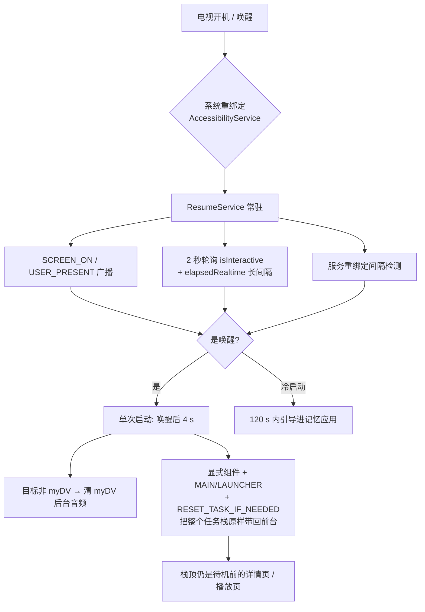

# 服务原理

> 面向想改代码的人。完整实现见 [`apk/src/com/wb/mydvresume/ResumeService.java`](../apk/src/com/wb/mydvresume/ResumeService.java)。
> 当前版本 v4.4（`versionCode 21 / 3.5`，自动学习白名单 + 唤醒严格单次启动；v4.3 的电视端版本横幅已移除）。

## 1. 整体架构



**没有界面、没有图标、没有桌面声明**：清单里只有一个 `exported=true`、由 `BIND_ACCESSIBILITY_SERVICE` 保护的 service。TCL 验证器会拒绝含 `CATEGORY_HOME` / `LAUNCHER` / `<queries>` 声明的非 TCL 签名 APK，所以这些一律不写。开机后由系统自动重新绑定服务，不需要 `BOOT_COMPLETED`。

## 2. 唤醒检测（三重）

v1 只靠 `onAccessibilityEvent` 结果事件根本不派发，从 v2 起改成三重：

1. `SCREEN_ON` / `USER_PRESENT` 系统广播；
2. 每 2 秒轮询 `PowerManager.isInteractive()`，并用 `elapsedRealtime` 的长间隔（跨待机时长）识别「刚亮屏」；
3. `onServiceConnected` 里比较本次绑定与上次绑定的间隔，服务被 TCL `FreezeManager` 冻结后重绑定也能补一次唤醒。

命中后设 `wokeAt`，**v4.4 起只在 `DELAYS = {4000}` 毫秒处启动一次**（`wakeLaunchOnce` 硬 gate 保证重复事件不再二次启动；`onAccessibilityEvent` 的 HOME 事件不再触发 launch）。启动点选在 4000ms 是为了**避开 TCL 亮屏后 2~3 秒才压桌面的动作**：v4.0～v4.3 用 5 次纠正（800/2500/5000/9000/13000ms）覆盖整个桌面争夺窗口，v4.4 按用户要求收敛为 1 次，因此把这一次放在桌面动作之后。v3.8 曾把 5 次压成 1 次却仍停在早期（0.8s 附近）导致回归——v4.4 的关键区别是**那唯一一次足够晚**。冷开机走独立的 `launchBoot()`，7 次纠正不受此 gate 影响。

## 3. v4.0 的任务栈恢复（核心）

唤醒时最终调用的 `launch()` 构造一个**干净**的 Intent：

```java
ComponentName cn = resolveBootIntent(pkg).getComponent();   // 显式组件
Intent bring = new Intent(Intent.ACTION_MAIN);
bring.addCategory(Intent.CATEGORY_LAUNCHER);
bring.setComponent(cn);
bring.setFlags(Intent.FLAG_ACTIVITY_NEW_TASK
        | Intent.FLAG_ACTIVITY_RESET_TASK_IF_NEEDED
        | Intent.FLAG_ACTIVITY_NO_ANIMATION);
startActivity(bring);
```

要点：

- **显式组件**：TCL 对第三方服务的隐式 `MAIN/LAUNCHER` intent 拒绝解析（实测连 `adb shell` 都报 unable to resolve），显式写法绕开该限制。组件来自静态表 `resolveBootIntent()`，解析不到就回退 myDV 的 `MainActivity`。
- **绝不能用 `FLAG_ACTIVITY_SINGLE_TOP`**：讴歌影视 `HomeActivity` 是 `singleTop`，而待机时栈顶通常是 `DetailActivity`，`SINGLE_TOP` 不命中就会**新建一个首页压上去**（A/B 实证：任务栈从 3 个变 4 个），这正是「进应用了、在首页、有声音没画面」的直接原因。
- `RESET_TASK_IF_NEEDED` 提供 launcher 语义：桌面在前台时系统返回 `its current task has been brought to the front`，**整个任务栈原样带回、栈顶仍是原页面、不新建任何 Activity**。
- 这个调用是**幂等**的；v4.0～v4.3 靠这一点执行 5 次纠正也不会叠页面，v4.4 收敛为 1 次。若系统拒绝该 Intent，会 `catch` 后走 legacy fallback（旧的显式 `SINGLE_TOP` 启动），保证不会比旧版更差。
- v4.0 删除了 v3.6 的「精确恢复」分支：它每次都因 `DetailActivity` / `PlayActivity` `exported=false` 抛 `SecurityException`，且可能抢先返回；任务栈复用已能保留整个栈顶，不需要它。`SCREEN_OFF` 时仍会记录当时的 class，用于诊断日志和 `--wake-report`。

## 4. 冷启动目标（C 折中）

- 用 `boot_id` 变化 / `elapsedRealtime` 负间隔判断是冷启动而非唤醒。
- `UsageStatsManager` 的 `ACTIVITY_RESUMED` 与 `class=` 事件流判断关机/待机前最后用的应用，辅以本地 `last_app` 兜底。
- 默认回 myDV；v4.2 起「允许记忆」= 静态 `wb_boot_whitelist` ∪ **运行时自动学习的自装应用集合**，新装应用无需任何电脑侧配置（见第 10 节）。
- 120 秒纠正窗口；用户按键或主动打开别的应用即取消劫持，避免抢操作。
- 冷启动 `launchBoot()` 仍用显式组件启动，v4.0 未改动这部分。

## 5. myDV 后台音频静音

myDV 在待机后常驻后台继续出声，唤醒别的应用时会叠一层声音。`PIP_PAUSE` receiver 不导出、MediaSession 不可控，所以 v3.5 起改用：

```java
ActivityManager.killBackgroundProcesses("com.github.mytv.dv");
```

在每次唤醒纠正里执行（位于启动目标应用之前），并多次补刀。开关 `wb_quiet_mydv=1`。

## 6. 配置、权限与后台策略

| 类别 | 值 |
| --- | --- |
| 系统设置 | `wb_boot_target`、`wb_boot_whitelist`（14 个自装应用）、`wb_quiet_mydv=1`、`wb_exact_resume=1`（v4.0 起不再使用该分支，保留兼容） |
| appops | `APP_AUTO_START allow`、`APP_ASSOC_START allow`、`GET_USAGE_STATS allow` |
| 电池 | `cmd deviceidle whitelist +com.wb.mydvresume`（另给讴歌影视加过，防止被清后台，可撤销） |
| 无障碍 | `settings put secure accessibility_enabled 1`、`enabled_accessibility_services` 里同时保留 TCL 小 T 助手 + myDV Resume |
| APK 权限 | `SYSTEM_ALERT_WINDOW`、`PACKAGE_USAGE_STATS`、`KILL_BACKGROUND_PROCESSES` |

**每次覆盖安装后系统都会重置无障碍绑定与后台策略**，必须重跑 `finalize_resume.py`（它会 toggle `enabled_accessibility_services` 触发系统重绑定，再补 appops / 电池白名单）。只写 `settings` 不重绑会出现服务 Bound 不上、`forbid bind service` 的情况。

## 7. 已知的诊断入口

```bash
python boot_target.py --status            # 配置与目标
python boot_target.py --list-apps         # 自装应用
python boot_target.py --all-apps          # 重扫静态白名单（v4.2 起通常不再需要）
python verify_autolearn.py --follow       # 自动学习集合 / 唤醒目标 / fallback 核查
python boot_target.py --wake-report       # 唤醒 / 待机时序与 class
python boot_target.py --boot-report       # 冷启动判定
python boot_target.py --exact-off         # 关闭精确恢复分支
python verify_quiet.py --clear / --report # 静音实测（SCREEN_OFF → WAKE → quiet 时序）
python reboot_verify.py                   # 重启后配置保留核查
```


## 9. v4.1：唤醒目标解析（避免回退到 myDV）

v4.0 解决了「回到哪个界面」，但没有保证「回到哪个应用」。Android 11 的包可见性限制下，第三方服务无法解析别的包的 launcher intent，因此启动入口依赖 `KNOWN_COMPONENTS` 静态表；白名单后来新增的红果TV 没进这张表，`resolveBootIntent()` 返回 null，`resolveWakeTarget()` 就静默回退到默认目标 myDV。

v4.1 的目标解析顺序：

1. `SCREEN_OFF` 时把 `last_class_pkg` / `last_class` / `last_class_at` 写入 SharedPreferences（`commit()` 同步落盘，防止快速休眠丢记录）。
2. 唤醒时 `resolveWakeTarget()` 先取 `last_class_pkg`，要求：记录时间 < 7 天、包在白名单内、`resolveBootIntent()` 能拿到 intent；命中即返回。
3. 否则退回 v3.4 的 `recentWhitelistedApp()`（UsageEvents 24h → UsageStats 3 天 → 本地 `last_app`），并在日志里打印 `standby=` 与 `fresh=` 便于诊断。
4. `resolveBootIntent()`：PackageManager → `KNOWN_COMPONENTS` → **新增**从 UsageEvents / 待机记录取真实 Activity 类构造显式 `ComponentName`。

`launch()` 的任务栈复用写法（显式组件 + MAIN/LAUNCHER + `RESET_TASK_IF_NEEDED`、无 `SINGLE_TOP`）、`quietMyDv()` 与冷启动逻辑均未改动。启动次数见第 2 节：v4.4 起由 5 次纠正收敛为 4000ms 单次 + 硬 gate。

## 10. v4.2：自动学习白名单

**为什么需要**：v4.1 的 `wb_boot_whitelist` 是 `boot_target.py --all-apps` 生成的一次性快照，`KNOWN_COMPONENTS` 是手工静态表。每装一个新应用都要连电脑重扫，否则 `resolveBootIntent()` 拿不到组件、唤醒静默回退 myDV。

**运行时数据流**：

```
onServiceConnected() ──> refreshInstalledApps("bind")  全量扫描 pm -3 语义的自装应用
PACKAGE_ADDED/REPLACED ─> learnPackage()   增量加入 + 缓存 launcher 组件
PACKAGE_REMOVED ────────> forgetPackage()  移除
SCREEN_OFF ─────────────> refreshInstalledApps("standby")  待机前最后兜底
        │
        ▼
dynamicAllow (HashSet) + SharedPreferences: learned_apps / cmp.<pkg>
        │
        ▼
isAllowed() = 静态白名单 ∪ dynamicAllow
        │
        ├─> lastAllowedForeground()      最近前台应用（UsageEvents）
        ├─> recordStandbyClass()        SCREEN_OFF 待机记录
        ├─> resolveWakeTarget()         唤醒目标
        └─> resolveBootIntent()         六级组件解析
                    │
                    ▼
        launch() 的 v4.0 任务栈复用（未改动）
```

**可见性前提**：`QUERY_ALL_PACKAGES`（普通安装时权限，无 `<queries>`，v3.9.1 已验证 TCL 验证器接受）。没有它，Android 11 下 `getInstalledPackages()` / `getLaunchIntentForPackage()` 对别的包会被过滤，自动学习无从谈起。

**六级组件解析**：leanback launcher intent → 标准 launcher intent → 限定包名的显式 `MAIN+LAUNCHER` 查询 → `KNOWN_COMPONENTS` 静态表 → 缓存的已学组件 → exported MAIN Activity / UsageEvents 观察类。只取 `ComponentName`，`launch()` 再重建干净的 Intent，所以解析方式不会影响已实测的任务栈行为。

**边界收紧（v4.2.1）**：只认 `ApplicationInfo.FLAG_SYSTEM == 0` 的真第三方包。v4.2 初版把 `FLAG_UPDATED_SYSTEM_APP` 也算进去，扫描到 29 个（TCL 有 ~13 个被 OTA 更新的系统应用），这些包带 exported MAIN Activity，理论上可能被拉成唤醒目标；收紧后 `userApps=15`，与 `pm list packages -3` 一致。

**配置**：`wb_auto_learn=0` 关闭动态学习（退回 v4.1 静态行为）；`wb_learn_exclude=<csv>` 排除指定包。`SKIP_PKGS` 硬编码排除桌面、安装器、系统 UI、服务自身。

**不能自动的部分**：TCL 的 `APP_AUTO_START` / `APP_ASSOC_START` appops 需要 shell 权限，第三方应用无法给别的应用授权。「待机 → 唤醒」主路径完全脱离电脑；**断电冷开机**自动进新装应用可选跑一次 `verify_autolearn.py --allow-autostart`。完整原理与实测日志见 [CHANGELOG.md 的 v4.2 章节](../CHANGELOG.md)。

## 11. v4.4：严格单次启动 + 移除电视端横幅

按用户要求做了两项调整：

**① 唤醒严格只启动一次。** v4.0～v4.3 在 `DELAYS = {800, 2500, 5000, 9000, 13000}` 处执行 5 次纠正，加上桌面 HOME 事件触发，实测一次唤醒可能出现 8～11 条 `launched … (task reuse)`。v4.4 收敛为：

```java
private static final long[] DELAYS = {4000L};          // 唯一启动点，在 TCL 推 HOME 之后
private boolean wakeLaunchOnce = false;                // onWake() 里重置
// launch() 开头：
if (wakeLaunchOnce) { Log.d(TAG, "wake launch skipped: ..."); return; }
lastLaunchAt = now;
wakeLaunchOnce = true;                                 // 消耗本次 wake 唯一的一次启动
```

同时 `onAccessibilityEvent()` 里 HOME 命中只记日志、**不再调用 `launch()`**（否则会在 4000ms 之前过早启动，被 TCL 随后压下的桌面盖住——这正是 v3.8 回归的根因）。冷开机走独立的 `launchBoot()`，7 次纠正不受 `wakeLaunchOnce` 影响。日志里每次 WAKE 应只有 1 条 `launched … (task reuse)`。

**② 彻底移除 v4.3 的推送横幅。** 删除了服务里的 `PUSH_BANNER` 接收器、`showBanner()` / `hideBanner()`、`TYPE_ACCESSIBILITY_OVERLAY` 窗口及全部相关 import；`push_apk.py` 删除了 `push_banner()` 与 `--banner-only` / `--hide-banner`。**2026-11-20 更正**：弹窗并非全写死——`tv_title` / 按钮是固定控件，但 `tv_content` 的前缀来自 `159>>X>>0` 握手帧第 2 项（来源名，官方填手机型号）。`push_source()` 现填入版本，TCL **原生弹窗**直接显示版本，不需要覆盖层；`--plain-source` 回退成「1」。PC 控制台仍保留推送横幅与 `VERSION CHECK`。详见 [troubleshooting.md](troubleshooting.md)。

**未改动**：`launch()` 的任务栈复用写法（显式组件 + MAIN/LAUNCHER + `RESET_TASK_IF_NEEDED`、无 `SINGLE_TOP`）、`quietMyDv()`、自动学习集合与六级组件解析、冷启动逻辑。核查命令见 [build-and-push.md](build-and-push.md)。
